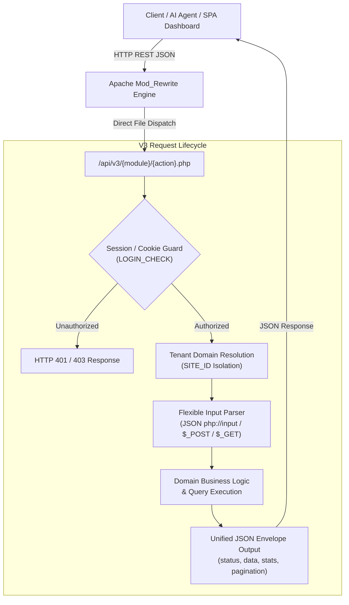

# V3 REST API Specification & Architecture Guide

> **Target Audience:** Autonomous AI Agents, LLM Function Calling Systems, and Frontend/Backend Software Engineers.  
> **API Version:** `3.0.0`  
> **Protocol Standard:** RESTful JSON Envelope over HTTP/HTTPS  
> **Base Path:** `/api/v3/` or `/API/v3/` (Case-insensitive routing via Apache mod_rewrite)

---

## 1. Executive Architecture & Core Philosophy

The ISW V3 API Suite is a high-performance, multi-tenant application backend purpose-built for Travel CRM, Tour Catalog Management, Smart AI Itinerary Generation, Visual Automation Workflows, and Omnichannel WhatsApp CRM communications.

### 1.1 Architectural Overview



### 1.2 Multi-Tenant Isolation Protocol

Every API invocation in V3 is strictly scoped to a specific tenant workspace (`site_id`):
1. **Host Header Resolution:** The backend automatically identifies tenant workspaces by mapping `$_SERVER['HTTP_HOST']` against the `site_domain` and `site_url` registry in `isw_site`.
2. **Session / Cookie Fallback:** If the hostname points to the master cluster or localhost, tenant context falls back to `$_SESSION['site_id']` or `$_COOKIE['user_site_id']`.
3. **Data Segregation:** All SQL queries strictly enforce `enquiry_site_id = {$siteId}`, `tour_package_site_id = {$siteId}`, etc. Cross-tenant leakage is strictly prevented at the query builder layer.

### 1.3 URL Convention & Routing Rules

Due to Apache rewrite rules in `.htaccess`, endpoints support two equivalent URL syntaxes:
- **Direct File Route:** `/api/v3/leads/list.php`
- **Clean REST Route:** `/api/v3/leads/list/` or `/api/v3/leads/list`
- **Master Router Bridges:** Root helper bridges exist for key modules (`/api/v3/auth.php`, `/api/v3/workflows/`, `/api/v3/setting.php`).

---

## 2. Authentication, RBAC & Security

### 2.1 Authentication Methods

| Auth Type | Mechanism | Headers / Cookies Required | Applicable Scenarios |
| :--- | :--- | :--- | :--- |
| **Session Cookie (Standard)** | PHP Native Session | `Cookie: PHPSESSID=...` | SPA Frontend Dashboard |
| **Salt Token (V3 Extended)** | Base64-encoded User Salt Key | `Cookie: user_data=<base64_salt_key>; isLogin=1` | Persistent sessions, AI Agents, Native Apps |
| **Direct Postman/AI Agent** | Automated login session creation | Call `POST /api/v3/auth/login.php` once, reuse session cookies | Scripted workflows, Autonomous bots |

### 2.2 Role-Based Access Control (RBAC) Matrix

The system validates `site_access_type` (`$_SESSION['user_role']`):

| Role Identifier | Permissions Summary | PII Access (Phone/Email) | Restricted Endpoints |
| :--- | :--- | :--- | :--- |
| `administrator` / `admin` | Full workspace permissions, site config, staff management | Full Access | None |
| `operations` / `manager` | Lead pipeline, itineraries, transporter quotations, vouchers | Full Access | Global SaaS config |
| `accountant` | Invoicing, payment link generation, transaction ledger auditing | Full Access | Lead deletion |
| `agent` / `calling_agent` | Personal lead pipeline, quotations, WhatsApp chat | Full Access (assigned leads) | Accounts approval, global settings |
| `digital_marketing` | Performance reports, Google Ads integration, campaign analytics | **MASKED (Hidden)** | Customer phone numbers, emails, and address fields return empty or redacted |
| `customer` | View public itineraries, approve quotes, make payments | Own records only | Internal CRM endpoints |

---

## 3. Unified Protocol Envelope

### 3.1 Input Parsing Flexibility

V3 endpoints accept parameters across multiple formats seamlessly:
- **JSON Body:** `Content-Type: application/json` payload via `php://input`.
- **Form URL Encoded:** Standard `application/x-www-form-urlencoded` via `$_POST`.
- **Query Parameters:** `$_GET` for sorting, filters, and pagination.
- **Identifier Agnosticism:** Parameters accept both raw integers (`id=42`) and base64 encoded strings (`id=NDI=`).
- **Naming Aliases:** Common parameters accept both snake_case and camelCase (e.g., `lead_id`, `leadId`, `enquiry_id`, and `id` are all accepted).

### 3.2 Standard Success Response Envelope

```json
{
  "status": 200,
  "msg": "Operation completed successfully.",
  "data": [
    {
      "id": 42,
      "name": "Rajesh Sharma",
      "mobile": "+919876543210",
      "status": 1
    }
  ],
  "stats": {
    "fresh": 12,
    "confirmed": 5,
    "followup": 8
  },
  "pagination": {
    "current_page": 1,
    "total_pages": 4,
    "total_records": 78,
    "limit": 20,
    "offset": 0
  }
}
```

### 3.3 Standard Error Response Envelope

```json
{
  "status": "error",
  "code": "record_not_found",
  "message": "The requested lead record could not be found or has expired.",
  "http_code": 404
}
```

### 3.4 HTTP Status Codes Dictionary

- `200 OK`: Request succeeded.
- `201 Created`: Resource successfully created.
- `400 Bad Request`: Missing mandatory parameters or invalid input format.
- `401 Unauthorized`: Missing or expired session credentials.
- `403 Forbidden`: User role lacks permission (e.g. digital marketing attempting to view customer PII).
- `404 Not Found`: Endpoint or referenced resource does not exist.
- `405 Method Not Allowed`: HTTP method mismatch (e.g. GET on a POST-only action).
- `500 Internal Error`: Database or execution failure.

---

## 4. Module-by-Module API Reference

### 4.1 Authentication & Onboarding

#### `POST /api/v3/auth/login.php`
Authenticates a user and initializes a secure session.
- **Headers:** `Content-Type: application/json`
- **Request Body:**
  ```json
  {
    "identifier": "agent@travelagency.com",
    "password": "AccountPassword123",
    "redirect_url": "/dashboard/"
  }
  ```
- **Response `200 OK`:**
  ```json
  {
    "status": "success",
    "msg": "Welcome back, Agent Name!",
    "redirect_url": "/dashboard/",
    "user": {
      "id": 5,
      "encoded_id": "NQ==",
      "name": "Agent Name",
      "email": "agent@travelagency.com",
      "role": "agent"
    }
  }
  ```

#### `POST /api/v3/auth/send-otp.php`
Dispatches a 6-digit email OTP for passwordless authentication.
- **Request Body:** `{"email": "user@example.com"}`
- **Response:** `{"status": "success", "msg": "OTP sent successfully."}`

#### `POST /api/v3/auth/verify-otp.php`
Validates the OTP code and creates the session.
- **Request Body:** `{"email": "user@example.com", "otp": "491823"}`
- **Response:** `{"status": "success", "user": { ... }}`

#### `GET /api/v3/auth/check-domain.php`
Checks if a workspace subdomain is available for registration.
- **Query Params:** `subdomain=bluesky`
- **Response:** `{"status": "success", "available": true, "msg": "Subdomain is available."}`

---

### 4.2 Leads & CRM Pipeline

#### `GET /api/v3/leads/list.php`
Fetches a paginated directory of enquiries with filter parameters and top-bar KPI statistics.
- **Query Parameters:**
  - `page` *(int, default: 1)*: Page number.
  - `limit` *(int, default: 20)*: Items per page (max 100).
  - `status` *(string)*: `1` (Fresh), `2` (Pending), `3` (Followup), `6` (Confirmed), `16` (Cancel), `9` (Quote Sent), or comma-separated list `1,2,3`.
  - `search` *(string)*: Free-text search matching name, mobile, email, subject, or ID.
  - `daterange` *(string)*: `'YYYY-MM-DD - YYYY-MM-DD'` or `'all'`. Default: Last 30 days.
  - `agentId` *(string)*: Agent user ID or `'unassigned'`.
- **Response `200 OK`:**
  ```json
  {
    "status": 200,
    "data": [
      {
        "id": 42,
        "encoded_id": "NDI=",
        "name": "Rajesh Sharma",
        "first_name": "Rajesh",
        "last_name": "Sharma",
        "mobile": "+919876543210",
        "email": "rajesh@example.com",
        "subject": "Kashmir 5N/6D Package Enquiry",
        "source": "Google Ads",
        "status": 1,
        "status_label": "Fresh",
        "agent_name": "Anita Verma",
        "created_at": "2026-10-25 14:30:00"
      }
    ],
    "stats": {
      "total": 45,
      "fresh": 12,
      "confirmed": 6,
      "followup": 14,
      "cancel": 3
    },
    "pagination": {
      "current_page": 1,
      "total_pages": 3,
      "total_records": 45,
      "limit": 20
    }
  }
  ```

#### `GET /api/v3/leads/view.php`
Retrieves comprehensive details for a single lead.
- **Query Params:** `id=42` (or base64 encoded `id=NDI=`).
- **Response `200 OK`:** Returns customer profile, travel specs (destination, budget, pax count), activity history, notes, quotes sent, and payments.

#### `POST /api/v3/leads/create.php`
Creates a new customer lead in the pipeline.
- **Request Body:**
  ```json
  {
    "first_name": "Priya",
    "last_name": "Nair",
    "mobile": "+919811223344",
    "email": "priya.nair@example.com",
    "subject": "Goa 4N/5D Family Holiday",
    "destination": "Goa",
    "source": "Website Form",
    "adults": 2,
    "children": 1,
    "travel_date": "2026-11-15"
  }
  ```

#### `POST /api/v3/leads/update-status.php`
Advances a lead through the CRM pipeline stages.
- **Request Body:**
  ```json
  {
    "id": "42",
    "status": 3,
    "reason": "Customer requested follow-up next Tuesday afternoon"
  }
  ```

#### `POST /api/v3/leads/assign.php`
Assigns or transfers a lead to a specific sales agent.
- **Request Body:**
  ```json
  {
    "lead_id": "42",
    "agent_id": 7,
    "notes": "Honeymoon client requiring luxury 5-star villa options."
  }
  ```

#### `POST /api/v3/leads/add-note.php`
Appends an internal note or logs customer contact details.
- **Request Body:**
  ```json
  {
    "leadId": "42",
    "title": "Call Summary",
    "msg": "Client confirmed budget of ₹75,000 for 2 adults.",
    "followupTime": "2026-10-30 14:00:00"
  }
  ```

---

### 4.3 Tour Packages Catalog

#### `GET /api/v3/packages/list.php`
Fetches tour packages with destination and pricing filters.
- **Query Params:** `type=domestic` (`domestic` | `international` | `all`), `page=1`, `limit=20`, `search=himachal`.
- **Response `200 OK`:** Returns package list with duration, theme, destinations, active pricing slabs, and cover image.

#### `GET /api/v3/packages/get.php`
Fetches complete package itinerary record with day-by-day plans, hotels, and inclusions.
- **Query Params:** `id=105`
- **Response `200 OK`:** Contains full itinerary structure, days, hotel assignments, and transportation specifications.

#### `POST /api/v3/packages/publish.php`
Creates a new tour package or publishes full updates.
- **Request Body:**
  ```json
  {
    "packageName": "Golden Triangle Tour 5D/4N",
    "duration": 5,
    "packageType": "domestic",
    "tourPackageTemplate": "mit",
    "hotel": "4_star_hotel",
    "outstationVehicle": "sedan_swift_dzire",
    "overview": "Comprehensive tour covering Delhi, Agra, and Jaipur.",
    "inclusions": "Daily breakfast, Private AC Cab, 4-Star Hotels, Guided monument tours",
    "exclusions": "Airfare, Monument entrance tickets, Personal expenses"
  }
  ```

#### `GET /api/v3/packages/prices.php`
Retrieves seasonal pricing slabs and markup tiers for a package.
- **Query Params:** `id=105`

#### `POST /api/v3/packages/prices.php`
Creates, modifies, or deletes package pricing slabs.
- **Request Body:**
  ```json
  {
    "action": "update",
    "package_id": "105",
    "selling_adult": 16500.00,
    "selling_child": 8250.00,
    "date_start": "2026-11-01",
    "date_end": "2027-01-31"
  }
  ```

---

### 4.4 Smart AI Itinerary Generator & Quotations

#### `POST /api/v3/itinerary/generate.php`
Triggers the smart heuristic AI itinerary generator to construct a customized day-by-day plan.
- **Request Body:**
  ```json
  {
    "destination": "Kashmir",
    "duration": 6,
    "theme": "Honeymoon",
    "lead_id": "42",
    "travelers_adults": 2,
    "travelers_children": 0,
    "hotel_rating": "4_star"
  }
  ```
- **Response `200 OK`:**
  ```json
  {
    "status": "success",
    "itinerary": {
      "title": "Romantic Kashmir Getaway 6D/5N",
      "days": [
        {
          "day": 1,
          "title": "Arrival in Srinagar & Shikara Ride",
          "description": "Arrive at Srinagar Airport. Transfer to Dal Lake Houseboat. Evening sunset Shikara ride.",
          "hotel": "Mascot Houseboats",
          "meals": "Dinner"
        }
      ],
      "pricing": {
        "total_amount": 48500.00,
        "per_person": 24250.00
      }
    }
  }
  ```

#### `GET /api/v3/itinerary/show.php`
Renders the quotation presentation for client dispatch (supports `template=mit`, `standard`, `modern`, `aleya`).

---

### 4.5 Visual Automation Workflows Engine

The V3 automation engine powers visual trigger-action pipelines.

#### `GET /api/v3/workflows/?action=list`
Lists all visual automations for the active site.

#### `GET /api/v3/workflows/?action=get&id=12`
Fetches flowchart canvas nodes, edge connections, and execution rules.

#### `POST /api/v3/workflows/`
Saves or modifies workflow definitions.
- **Request Body:**
  ```json
  {
    "action": "save",
    "id": 12,
    "title": "Instant WhatsApp Welcome on Fresh Lead",
    "trigger_type": "lead_created",
    "nodes": [
      {
        "id": "node_1",
        "type": "trigger",
        "data": { "event": "lead_created", "source": "all" }
      },
      {
        "id": "node_2",
        "type": "action",
        "data": { "action": "send_whatsapp", "template": "welcome_brochure" }
      }
    ],
    "edges": [
      { "id": "edge_1_2", "source": "node_1", "target": "node_2" }
    ]
  }
  ```

---

### 4.6 WhatsApp CRM & Omnichannel Messaging

#### `GET /api/v3/whatsapp/chats.php`
Fetches active conversation threads with matching customer names, unread messages, and lead stages.

#### `GET /api/v3/whatsapp/messages.php?chat_id=45`
Retrieves message history for a specific chat.

#### `POST /api/v3/whatsapp/messages.php`
Sends an outbound WhatsApp message, document, or media attachment.
- **Request Body:**
  ```json
  {
    "chat_id": 45,
    "phone": "+919876543210",
    "text": "Hello Rajesh, here is your finalized travel itinerary quotation for Kashmir.",
    "type": "document",
    "media_url": "/upload/whatsapp/quote_kashmir_42.pdf"
  }
  ```

---

### 4.7 Transporters & Fleet Logistics

#### `GET /api/v3/transporters/list.php`
Lists active transport vendors and fleet capabilities.

#### `POST /api/v3/transporters/quotation.php`
Calculates transport costs and generates fleet quotations.
- **Request Body:**
  ```json
  {
    "action": "send",
    "quotation_id": "210",
    "lead_id": "42",
    "vehicle_type": "Toyota Innova Crysta",
    "pickup_city": "Delhi",
    "drop_city": "Manali",
    "total_km": 1150,
    "rate_per_km": 19.00,
    "driver_allowance": 2500.00
  }
  ```

#### `GET /api/v3/vehicles/list.php`
Returns the master catalog of vehicle models (sedans, SUVs, tempo travellers, luxury coaches).

---

### 4.8 Accommodations & Property Management

#### `GET /api/v3/properties/index.php`
Lists hotel properties with filters for city location, star rating, and room types.

#### `GET /api/v3/properties/detail.php?id=56`
Retrieves single hotel details, room inventories, amenities, and gallery images.

---

### 4.9 Accounts & Financial Ledger

#### `GET /api/v3/accounts/transactions.php`
Audits received customer payments and transaction records. (Restricted to `administrator` and `accountant` roles).

#### `POST /api/v3/accounts/verify-payment.php`
Approves or rejects a payment note.
- **Request Body:**
  ```json
  {
    "note_id": 89,
    "action": "approve",
    "reason": "Payment credited to HDFC Current Account (Ref #98234123)."
  }
  ```

---

### 4.10 Settings & Integrations Hub

#### `GET /api/v3/setting/configuration.php`
Retrieves tenant website configuration (company branding, contact info, banking details, social links).

#### `GET /api/v3/integration/index.php`
Lists active integrations (Razorpay, Cashfree, PhonePe, Google Ads, SMTP, Webhooks).

#### `POST /api/v3/shortener/shorten.php`
Generates a concise URL shortener link for SMS and WhatsApp dispatch.
- **Request Body:** `{"url": "https://crm.example.com/quote/?ref=NDI="}`
- **Response:** `{"status": "success", "short_url": "https://crm.example.com/s/x9k2p"}`

---

## 5. AI Agent Tool-Calling & LLM Integration

This section defines standard tool schemas so that autonomous AI agents (OpenAI GPT-4, Google Gemini, Anthropic Claude) can invoke V3 APIs directly via native function calling.

### 5.1 Semantic Intent-to-Endpoint Mapping

| User Natural Language Intent | AI Function Call | Corresponding V3 Endpoint |
| :--- | :--- | :--- |
| *"Show me new leads received today"* | `v3_leads_list(status="1", daterange="today")` | `GET /api/v3/leads/list.php` |
| *"Assign lead #42 to Anita"* | `v3_leads_assign(lead_id="42", agent_id=7)` | `POST /api/v3/leads/assign.php` |
| *"Mark lead #42 as Follow-up next Friday"* | `v3_leads_update_status(id="42", status=3, reason="...")` | `POST /api/v3/leads/update-status.php` |
| *"Generate a 5-day honeymoon package for Kerala"* | `v3_itinerary_generate(destination="Kerala", duration=5, theme="Honeymoon")` | `POST /api/v3/itinerary/generate.php` |
| *"Send WhatsApp quote to +919876543210"* | `v3_whatsapp_send(phone="+919876543210", text="...", media_url="...")` | `POST /api/v3/whatsapp/messages.php` |
| *"Check overall conversion rate and revenue"* | `v3_dashboard_overview()` | `GET /api/v3/dashboard/overview.php` |

### 5.2 JSON Schema Tool Definitions for LLMs

```json
[
  {
    "type": "function",
    "function": {
      "name": "v3_leads_list",
      "description": "Fetch a paginated list of customer leads with status and date filters.",
      "parameters": {
        "type": "object",
        "properties": {
          "status": {
            "type": "string",
            "description": "Status code filter: '1' (fresh), '2' (in-progress), '3' (followup), '6' (confirmed), '16' (cancel), 'all'."
          },
          "search": {
            "type": "string",
            "description": "Search keyword matching customer name, mobile, email, or destination."
          },
          "limit": {
            "type": "integer",
            "description": "Number of records to fetch (default: 20)."
          }
        }
      }
    }
  },
  {
    "type": "function",
    "function": {
      "name": "v3_leads_assign",
      "description": "Assign a customer lead to a sales agent executive.",
      "parameters": {
        "type": "object",
        "required": ["lead_id", "agent_id"],
        "properties": {
          "lead_id": { "type": "string", "description": "Lead identifier (numeric or base64)" },
          "agent_id": { "type": "integer", "description": "Target sales agent user ID" },
          "notes": { "type": "string", "description": "Assignment instructions or priority remark" }
        }
      }
    }
  },
  {
    "type": "function",
    "function": {
      "name": "v3_itinerary_generate",
      "description": "Generate a day-by-day smart travel itinerary using AI heuristics.",
      "parameters": {
        "type": "object",
        "required": ["destination", "duration"],
        "properties": {
          "destination": { "type": "string", "description": "Destination city or region (e.g. Kashmir, Kerala, Goa)" },
          "duration": { "type": "integer", "description": "Trip duration in days (e.g. 5)" },
          "theme": { "type": "string", "description": "Trip style: Honeymoon, Family, Adventure, Luxury" },
          "lead_id": { "type": "string", "description": "Optional associated CRM lead ID" }
        }
      }
    }
  },
  {
    "type": "function",
    "function": {
      "name": "v3_whatsapp_send",
      "description": "Send an outbound WhatsApp message or quotation PDF to a client.",
      "parameters": {
        "type": "object",
        "required": ["phone", "text"],
        "properties": {
          "phone": { "type": "string", "description": "Client mobile phone number with country code" },
          "text": { "type": "string", "description": "Message body text" },
          "media_url": { "type": "string", "description": "Optional document or photo URL to attach" }
        }
      }
    }
  }
]
```

---

## 6. Developer Integration & Code Samples

### 6.1 JavaScript / TypeScript Fetch Client

```javascript
/**
 * ISW V3 API Client Helper
 */
class V3ApiClient {
  constructor(baseUrl = '/api/v3') {
    this.baseUrl = baseUrl.replace(/\/$/, '');
  }

  async request(endpoint, options = {}) {
    const url = `${this.baseUrl}/${endpoint.replace(/^\//, '')}`;
    const headers = {
      'Accept': 'application/json',
      ...(options.headers || {})
    };

    if (options.body && typeof options.body === 'object' && !(options.body instanceof FormData)) {
      headers['Content-Type'] = 'application/json';
      options.body = JSON.stringify(options.body);
    }

    const response = await fetch(url, {
      credentials: 'same-origin', // Transmits session cookies
      ...options,
      headers
    });

    const data = await response.json();
    if (!response.ok) {
      throw new Error(data.message || data.msg || `Request failed with status ${response.status}`);
    }
    return data;
  }

  // Lead Methods
  getLeads(params = {}) {
    const q = new URLSearchParams(params).toString();
    return this.request(`leads/list.php?${q}`);
  }

  createLead(payload) {
    return this.request('leads/create.php', { method: 'POST', body: payload });
  }

  updateLeadStatus(leadId, status, reason = '') {
    return this.request('leads/update-status.php', {
      method: 'POST',
      body: { id: leadId, status, reason }
    });
  }

  // WhatsApp Dispatch
  sendWhatsAppMessage(phone, text, mediaUrl = '') {
    return this.request('whatsapp/messages.php', {
      method: 'POST',
      body: { phone, text, media_url: mediaUrl }
    });
  }
}

// Example Usage
const api = new V3ApiClient();
api.getLeads({ status: '1', limit: 10 }).then(res => {
  console.log(`Fetched ${res.data.length} fresh leads:`, res.data);
});
```

### 6.2 Python Client Example

```python
import requests

class V3ApiSession:
    def __init__(self, base_url="https://crm.example.com/api/v3"):
        self.base_url = base_url.rstrip("/")
        self.session = requests.Session()
        self.session.headers.update({"Accept": "application/json"})

    def login(self, identifier, password):
        url = f"{self.base_url}/auth/login.php"
        res = self.session.post(url, json={"identifier": identifier, "password": password})
        res.raise_for_status()
        return res.json()

    def list_leads(self, status="1", limit=20):
        url = f"{self.base_url}/leads/list.php"
        res = self.session.get(url, params={"status": status, "limit": limit})
        res.raise_for_status()
        return res.json()

    def send_whatsapp(self, phone, message_text, media_url=None):
        url = f"{self.base_url}/whatsapp/messages.php"
        payload = {"phone": phone, "text": message_text}
        if media_url:
            payload["media_url"] = media_url
        res = self.session.post(url, json=payload)
        res.raise_for_status()
        return res.json()

# Example Usage
client = V3ApiSession()
client.login("admin@example.com", "Password@123")
leads = client.list_leads(status="1")
print(f"Total Fresh Leads: {leads.get('stats', {}).get('fresh', 0)}")
```

### 6.3 cURL Command Examples

```bash
# 1. Authenticate and save cookie session
curl -X POST "https://crm.example.com/api/v3/auth/login.php" \
  -c cookies.txt \
  -H "Content-Type: application/json" \
  -d '{"identifier": "admin@example.com", "password": "Password123"}'

# 2. Fetch fresh leads using stored cookies
curl -X GET "https://crm.example.com/api/v3/leads/list.php?status=1&limit=10" \
  -b cookies.txt \
  -H "Accept: application/json"

# 3. Create a new lead enquiry
curl -X POST "https://crm.example.com/api/v3/leads/create.php" \
  -b cookies.txt \
  -H "Content-Type: application/json" \
  -d '{
    "first_name": "Siddharth",
    "last_name": "Mehta",
    "mobile": "+919822334455",
    "email": "sid@example.com",
    "subject": "Manali 4N/5D Tour",
    "destination": "Manali"
  }'
```

---

## 7. Machine-Readable OpenAPI Artifact

For automated tool orchestration, code generation, and Postman import, the complete OpenAPI 3.1.0 JSON specification is available at:
- **File Location:** [`docs/api/v3-openapi.json`](file:///opt/homebrew/var/www/php/isw-app/docs/api/v3-openapi.json)
- **JSON Schema standard:** OpenAPI 3.1.0 with comprehensive `x-ai-tool-definition` decorators.

