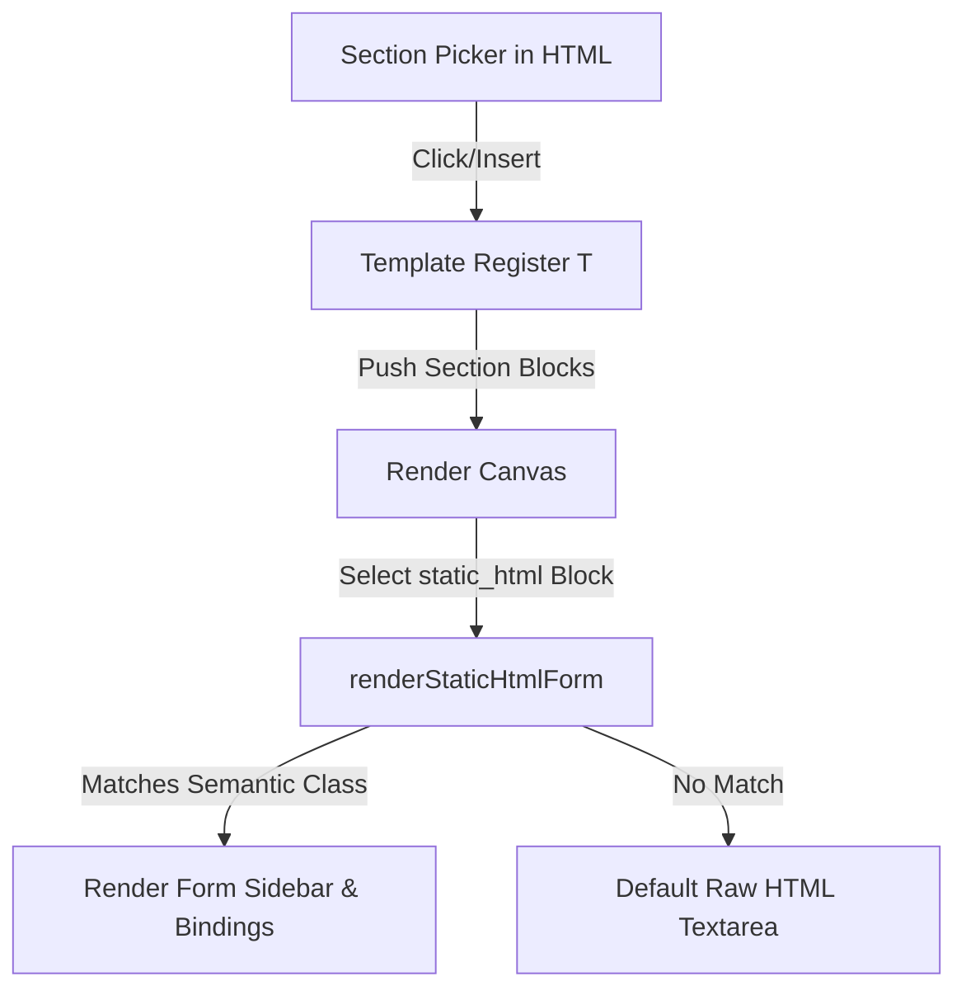

# Developer Guide: Adding Predefined Blocks & Visual Sidebar Editors

This guide outlines how to expand the No-Code Page Builder by registering new predefined layout sections, declaring template JSONs, and building custom visual sidebar editors to keep section modifications friendly and visual for non-technical users.

---

## Architecture Overview

The builder is composed of three layers:
1. **HTML Picker Sidebar (`no_code_editor.php`)**: Provides cards for dragging/clicking to add a new section.
2. **Template Registry (`no_code.js` -> `T`)**: Defines the initial state structure of the section blocks (using raw elements or semantic-class-wrapped `static_html`).
3. **Properties Sidebar (`no_code.js` -> `renderStaticHtmlForm`)**: Intercepts `static_html` block selections, looks for semantic classes, and renders form-based editors instead of raw HTML textareas.



---

## Step 1: Register the Picker Card

Add a picker card in [no_code_editor.php](file:///opt/homebrew/var/www/php/isw-app/app/default/administrator/desktop/templates/editor/no_code_editor.php) inside the appropriate category (Layout, Content, or Dynamic).

```html
<div class="sec-card" 
     data-type="your_block_type" 
     data-cat="layout" 
     data-kw="keywords search terms tag tags" 
     title="Tooltip showing block description to the user.">
    <i class="fi-rr-briefcase"></i><span>Your Block Name</span>
</div>
```

- **`data-type`**: The unique identifier key used in the template registry.
- **`data-cat`**: The tab category (`layout`, `content`, or `dynamic`).
- **`data-kw`**: Space-separated keywords for user search filtering.
- **`title`**: Descriptive tooltip explaining the block's layout.

---

## Step 2: Register the Section Template JSON

In [no_code.js](file:///opt/homebrew/var/www/php/isw-app/lib/resource/ui/plugin/no_code_editor/no_code.js), register the section template in the `T` registry object.

```javascript
const T = {
  // ... existing templates
  your_block_type: () => ({
    id: sid(),
    label: "Your Block Label",
    type: "your_block_section",
    settings: {
      background_color: "#ffffff",
      background_image: "",
      padding_top: "60",
      padding_bottom: "60",
      margin_top: "0",
      margin_bottom: "0",
    },
    blocks: [
      {
        id: bid(),
        type: "heading",
        tag: "h2",
        text: "Your Predefined Title",
        align: "center",
        color: "#111827",
        size: "32px",
        width: 100,
      },
      {
        id: bid(),
        type: "static_html",
        width: 100,
        content: `
          <div class="your-block-container" style="display:flex; gap:16px;">
            <div class="your-block-item" style="flex:1; padding:20px; background:#f9fafb; border-radius:8px;">
              <i class="your-item-icon fi-rr-sparkles"></i>
              <h4 class="your-item-title">Item Title</h4>
              <p class="your-item-desc">Item description goes here.</p>
            </div>
          </div>
        `,
      }
    ],
  }),
};
```

### Formatting Best Practices for static_html Templates
- Always include a **semantic root wrapper class** (e.g. `your-block-container`) and **item-level semantic classes** (e.g. `your-block-item`, `your-item-title`, `your-item-desc`). These are parsed by the form builder to detect the block type and populate the forms.
- Keep inline styling clean and simple. Prefer responsive utilities or flexbox/grid containers.

---

## Step 3: Implement Visual Sidebar Editor

### 1. Intercept Selection
In `renderStaticHtmlForm(blk)` within `no_code.js`, add a check to detect your semantic class and route it to your custom form builder:

```javascript
function renderStaticHtmlForm(blk) {
  const tempParser = new DOMParser();
  const tempDoc = tempParser.parseFromString(blk.content || "", "text/html");
  
  const isYourBlock = tempDoc.querySelector(".your-block-container, .your-block-item");

  if (isYourBlock) {
    renderYourBlockSidebarForm(blk, tempDoc);
  } else {
    // ... default fallbacks
  }
}
```

### 2. Form Builder & Handlers
Create the helper function that renders visual input fields for each element inside the block, handles add/delete items, and synchronizes state back to the canvas.

```javascript
function renderYourBlockSidebarForm(blk, tempDoc) {
  const container = tempDoc.querySelector(".your-block-container") || tempDoc.body;
  const items = Array.from(container.querySelectorAll(".your-block-item"));

  let html = `
    <div class="fg"><label>Block Type</label>
      <input class="fc" value="YOUR CUSTOM BLOCK" readonly style="opacity:.5;cursor:default;">
    </div>
    <div class="fg"><label>Width</label>
      <select class="fc" id="p-w">
        ${[25, 33, 50, 66, 75, 100].map(v => `<option value="${v}" ${blk.width == v ? "selected" : ""}>${v}%</option>`).join("")}
      </select>
    </div>
    <div class="divider"></div>
    <div class="section-title-label">Block Items</div>
    <div class="list-editor-items" style="display:flex; flex-direction:column; gap:12px;">
  `;

  // Render inputs dynamically for each existing item
  items.forEach((item, idx) => {
    const titleEl = item.querySelector(".your-item-title");
    const descEl = item.querySelector(".your-item-desc");
    
    html += `
      <div class="list-item-card" style="background:var(--bg-2); padding:10px; border-radius:var(--radius-md); border:1px solid var(--border); position:relative;">
        <button class="ctrl-btn danger" style="position:absolute; top:5px; right:5px; width:20px; height:20px;" data-del-idx="${idx}">&times;</button>
        <div class="fg">
          <label>Title</label>
          <input type="text" class="fc item-title-input" data-idx="${idx}" value="${escapeHtml(titleEl?.textContent || "")}">
        </div>
        <div class="fg">
          <label>Description</label>
          <textarea class="fc item-desc-input" data-idx="${idx}" rows="2">${escapeHtml(descEl?.textContent || "")}</textarea>
        </div>
      </div>
    `;
  });

  html += `
    </div>
    <button class="fc-btn" id="item-add-btn" style="margin-top:12px; width:100%;"><i class="fi-rr-plus"></i> Add Item</button>
    <div class="divider"></div>
    <button class="fc-btn secondary" id="raw-mode-btn" style="width:100%;"><i class="fi-rr-code"></i> Edit Raw HTML</button>
  `;

  propsBody.innerHTML = html;

  // Bind Common Width Input
  bind("p-w", "change", (v) => {
    snap();
    blk.width = parseInt(v);
    renderCanvas();
  });

  // Bind Input Changes to Live Preview
  propsBody.querySelectorAll(".item-title-input").forEach(input => {
    input.addEventListener("input", () => {
      const idx = parseInt(input.dataset.idx);
      const titleEl = items[idx].querySelector(".your-item-title");
      if (titleEl) titleEl.textContent = input.value;
      
      // Update template content
      blk.content = container.outerHTML;
      renderCanvas();
    });
    input.addEventListener("blur", snap); // Save history state
  });

  propsBody.querySelectorAll(".item-desc-input").forEach(textarea => {
    textarea.addEventListener("input", () => {
      const idx = parseInt(textarea.dataset.idx);
      const descEl = items[idx].querySelector(".your-item-desc");
      if (descEl) descEl.textContent = textarea.value;
      
      blk.content = container.outerHTML;
      renderCanvas();
    });
    textarea.addEventListener("blur", snap);
  });

  // Delete Action
  propsBody.querySelectorAll("[data-del-idx]").forEach(btn => {
    btn.addEventListener("click", () => {
      snap();
      const idx = parseInt(btn.dataset.delIdx);
      items[idx].remove();
      blk.content = container.outerHTML;
      renderCanvas();
      renderProps(); // Refresh sidebar form
    });
  });

  // Add Action
  document.getElementById("item-add-btn").addEventListener("click", () => {
    snap();
    const newItem = document.createElement("div");
    newItem.className = "your-block-item";
    newItem.style.cssText = "flex:1; padding:20px; background:#f9fafb; border-radius:8px;";
    newItem.innerHTML = `
      <i class="your-item-icon fi-rr-sparkles"></i>
      <h4 class="your-item-title">New Item Title</h4>
      <p class="your-item-desc">New item description.</p>
    `;
    container.appendChild(newItem);
    blk.content = container.outerHTML;
    renderCanvas();
    renderProps(); // Refresh sidebar form
  });

  // Raw HTML Editor Fallback
  document.getElementById("raw-mode-btn").addEventListener("click", () => {
    // Strip layout identification class to force raw mode fallback next render
    container.classList.remove("your-block-container");
    renderProps();
  });
}
```

---

## Important Rules for Forms
- Always wrap modifications to text, input selections, additions, and deletions in `snap()` to preserve the Undo/Redo stack.
- Trigger `renderCanvas()` immediately on `input` so modifications are real-time, but only call `snap()` on `blur` or when items are added/deleted. This prevents cluttering the undo history with individual keypresses.
- Fit sidebar items snugly within the 256px wide pane by using dense padding (`padding: 10px`), compact typography, and styling card elements cleanly.
